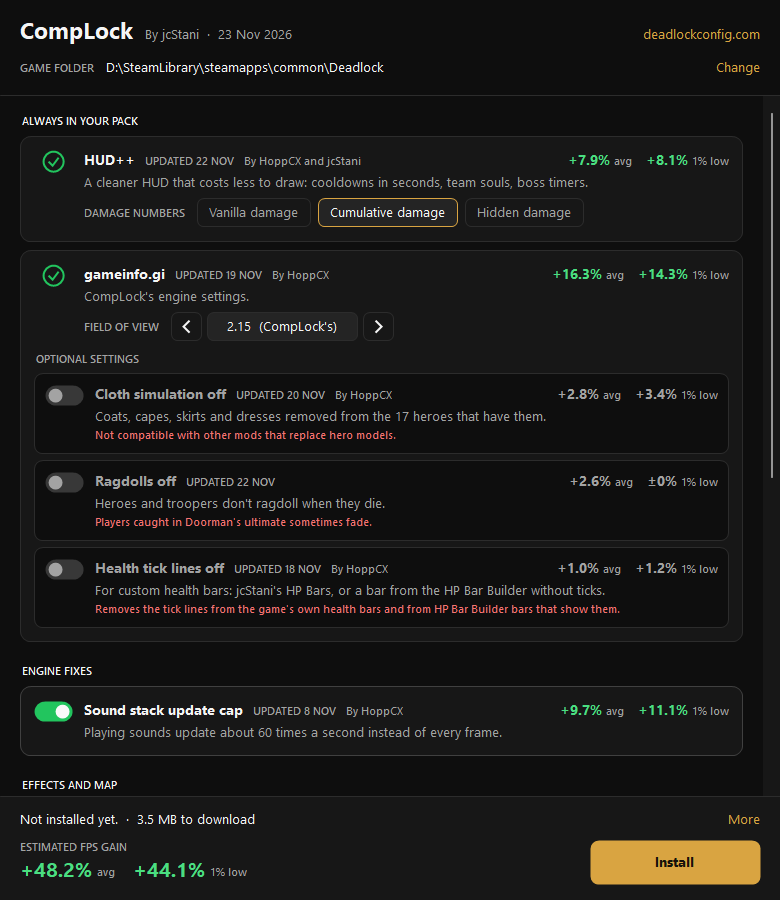

# CompLock Updater

Installs the [CompLock](https://deadlockconfig.com/) pack for Deadlock and shows when a mod has an update.

**[Download CompLock.exe](https://github.com/jcStani/CompLock-Updater/releases/latest/download/CompLock.exe)** and run it. There is nothing to install.

## What it changes

| Where | What |
|---|---|
| `game\citadel\addons\` | the pack's files |
| `game\citadel\gameinfo.gi` | the pack's gameinfo.gi (your old one is kept) |
| `video.txt` | only with Recommended Video Settings on (your old one is kept) |
| `%LOCALAPPDATA%\CompLock\` | its own settings and log |

It never touches game binaries or game memory, never asks for administrator rights, and never runs in the background.
Every download is checked before anything in the game folder changes.

## Windows warning

The exe is not signed, so Windows SmartScreen warns the first time it runs: More info, then Run anyway.

## Privacy

No account, telemetry or analytics. It only downloads the pack from deadlockconfig.com.

By jcStani. [MIT](LICENSE)
